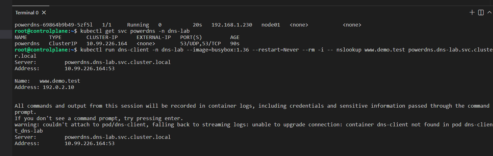
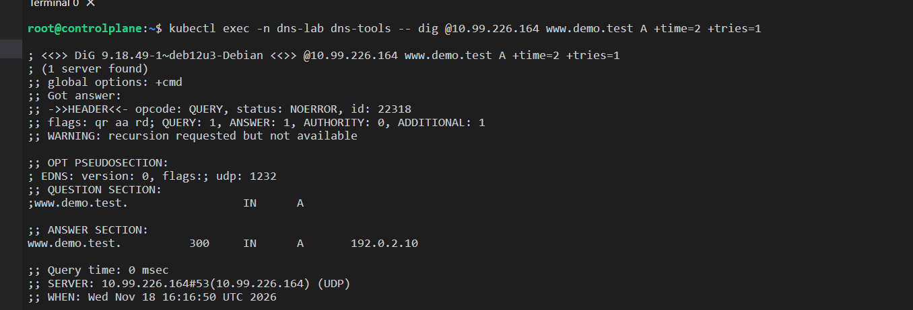

# Day 01 - Kubernetes DNS & PowerDNS Incident Recovery

## Objective

Deploy an authoritative PowerDNS server in Kubernetes, verify DNS resolution over UDP and TCP, simulate a networking failure, identify the root cause, and restore service availability.

## Lab Environment

| Component | Configuration |
|---|---|
| Platform | Killercoda Kubernetes Playground |
| Kubernetes cluster | Two nodes: controlplane and node01 |
| Namespace | `dns-lab` |
| DNS server | PowerDNS Authoritative |
| DNS zone | `demo.test` |
| Kubernetes resources | ConfigMap, Deployment, ClusterIP Service |
| Diagnostic tools | kubectl, nslookup, dig |
| DNS protocols | UDP and TCP, port 53 |

## Architecture

```text
DNS Client Pod (dns-tools)
          |
          | DNS query — UDP/TCP 53
          v
Kubernetes ClusterIP Service (powerdns)
          |
          | Service selector: app=powerdns
          v
PowerDNS Pod
          |
          v
Authoritative DNS Zone: demo.test
          |
          +-- www.demo.test → 192.0.2.10
          +-- api.demo.test → 192.0.2.20
          +-- ns1.demo.test → 192.0.2.53
```

## Phase 1 — Cluster and DNS Inspection

Before deploying PowerDNS, I investigated the existing Kubernetes DNS infrastructure.

Commands used:

```bash
kubectl get nodes
kubectl get pods -n kube-system -o wide
kubectl get svc -n kube-system
kubectl get configmap coredns -n kube-system -o yaml
kubectl describe svc kube-dns -n kube-system
```

I verified that CoreDNS was running and that Kubernetes workloads could resolve internal Service names and external domains.

## Phase 2 — Deploying PowerDNS

Created a dedicated namespace:

```bash
kubectl create namespace dns-lab
```

Deployed three Kubernetes resources:

- **ConfigMap:** Stores the PowerDNS configuration and DNS zone records.
- **Deployment:** Runs the PowerDNS authoritative server.
- **ClusterIP Service:** Exposes DNS over UDP and TCP port 53 inside the cluster.

Deployment commands:

```bash
kubectl apply --dry-run=client -f powerdns.yaml
kubectl apply -f powerdns.yaml
kubectl get pods -n dns-lab -o wide
kubectl get svc powerdns -n dns-lab
```

The PowerDNS Pod reached `1/1 Running`.

## Phase 3 — DNS Verification

Verified the DNS records using `nslookup` and `dig`.

**UDP query:**

```bash
kubectl exec -n dns-lab dns-tools -- dig @10.99.226.164 www.demo.test A
```

**TCP query:**

```bash
kubectl exec -n dns-lab dns-tools -- dig @powerdns.dns-lab.svc.cluster.local www.demo.test A +tcp
```

Expected response:

```text
status: NOERROR
flags: qr aa
www.demo.test. 300 IN A 192.0.2.10
```

Both queries succeeded.

The `aa` flag confirmed that the response was authoritative.

## Phase 4 — Simulated DNS Incident

### Incident Description

Simulated a Kubernetes networking failure in which the PowerDNS Pod remained running, but DNS queries through the Service stopped working.

### Fault Injection

Changed the Service selector to a label that did not match the PowerDNS Pod:

```bash
kubectl patch svc powerdns -n dns-lab -p '{"spec":{"selector":{"app":"powerdns-broken"}}}'
```

### Observed Symptoms

- PowerDNS Pod remained `Running`.
- The Service had no available backend endpoints.
- DNS queries failed with `host unreachable`.

### Investigation

```bash
kubectl get pods -n dns-lab
kubectl get svc powerdns -n dns-lab
kubectl get endpointslice -n dns-lab -l kubernetes.io/service-name=powerdns -o wide
```

The EndpointSlice showed no registered endpoints.

### Root Cause

The Kubernetes Service selector no longer matched the Pod labels.

As a result, Kubernetes could not associate the running PowerDNS Pod with the Service.

### Remediation

Restored the correct Service selector:

```bash
kubectl patch svc powerdns -n dns-lab -p '{"spec":{"selector":{"app":"powerdns"}}}'
```

### Recovery Verification

Retested DNS resolution:

```bash
kubectl exec -n dns-lab dns-tools -- dig @10.99.226.164 www.demo.test A +time=2 +tries=1
```

The query returned `NOERROR` and the expected A record:

```text
www.demo.test. 300 IN A 192.0.2.10
```

DNS resolution was successfully restored.

## Key Lessons Learned

1. A running Pod does not guarantee that its Service is reachable.
2. Service selectors and Pod labels must match for automatic endpoint discovery.
3. EndpointSlices are valuable for diagnosing Kubernetes Service routing issues.
4. DNS failures can originate in the networking layer rather than the DNS application.
5. Successful recovery must be verified through an end-to-end functional test.

## Production Considerations

This exercise was performed in an isolated lab environment.


## Lab Evidence

### 1. Healthy DNS Resolution

Successful authoritative DNS response before introducing the failure.



### 2. Simulated Service Failure

The PowerDNS Pod remained running, but the Service lost its endpoints and DNS queries failed.


### 3. Service Recovery

After correcting the Service selector, DNS resolution was restored.




A production deployment would require additional considerations such as high availability, persistent DNS data storage, monitoring, alerting, access controls, and controlled configuration changes.

## Outcome

Successfully deployed an authoritative DNS server, validated DNS resolution over UDP and TCP, and diagnosed and recovered from a simulated Kubernetes Service networking failure.
