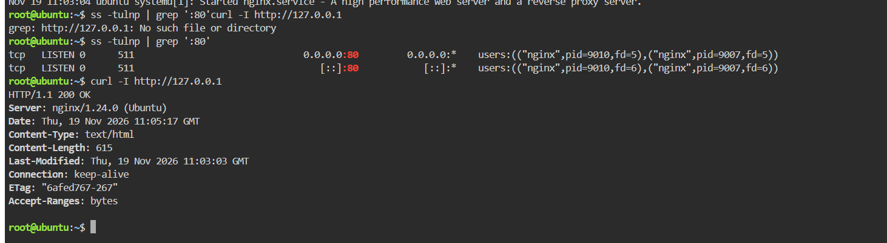
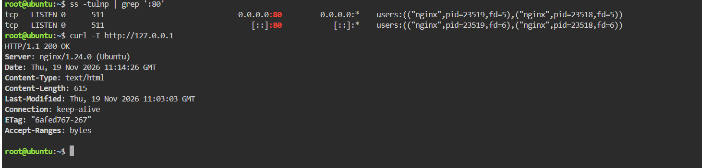

# Day 02 - Linux Service Administration & Nginx Incident Recovery

## Objective

Deploy an Nginx web server on Ubuntu Linux, establish a healthy operational baseline, simulate a configuration-related service outage, investigate the root cause, and restore service availability.

## Lab Environment

- Operating system: Ubuntu 24.04.5 LTS
- Service manager: systemd
- Web server: Nginx 1.24.0
- Networking: HTTP over TCP port 80
- Tools: systemctl, journalctl, nginx, ss, curl, sed

## 1. Deployment and Baseline Validation

Installed Nginx using the Ubuntu package manager:

```bash
apt update
apt install nginx -y
```

Verified the service state:

```bash
systemctl status nginx --no-pager
```

Confirmed that Nginx was running and enabled.

Checked the listening socket and HTTP response:

```bash
ss -tulnp | grep ':80'
curl -I http://127.0.0.1
```

**Result:** Nginx was listening on port 80 and returned HTTP 200 OK.

## 2. Simulated Production Incident

**Incident ID:** INC-002

**Symptom:** Nginx failed to start following a configuration change.

Created a backup of the original configuration:

```bash
cp /etc/nginx/nginx.conf /etc/nginx/nginx.conf.bak
```

Introduced an invalid directive:

```bash
sed -i '1i invalid_directive on;' /etc/nginx/nginx.conf
```

Attempted to restart Nginx:

```bash
systemctl restart nginx
```

**Result:** The service restart failed.

## 3. Investigation and Root Cause Analysis

Inspected the service state:

```bash
systemctl status nginx --no-pager -l
```

Reviewed the systemd journal:

```bash
journalctl -u nginx -n 30 --no-pager
```

Validated the Nginx configuration:

```bash
nginx -t
```

**Root cause:**

```text
unknown directive "invalid_directive" in /etc/nginx/nginx.conf:1
```

The invalid directive prevented Nginx's pre-start configuration validation from succeeding. Consequently, systemd could not start the service.

Repeated restart attempts could not resolve the problem because the underlying configuration error remained.

## 4. Incident Recovery

Restored the original configuration:

```bash
cp /etc/nginx/nginx.conf.bak /etc/nginx/nginx.conf
```

Validated the restored configuration:

```bash
nginx -t
```

After successful validation, restarted Nginx:

```bash
systemctl restart nginx
systemctl status nginx --no-pager
```

Verified network connectivity and HTTP functionality:

```bash
ss -tulnp | grep ':80'
curl -I http://127.0.0.1
```

**Recovery result:**

- Nginx returned to active (running).
- Configuration validation succeeded.
- TCP port 80 was listening.
- HTTP requests returned 200 OK.

## 5. Lessons Learned

1. A failed service restart is a symptom, not necessarily the root cause.
2. systemd status and journal logs provide valuable diagnostic evidence.
3. Application-specific configuration validation can identify the precise failure.
4. Configuration backups support safe rollback.
5. Recovery should be verified at service, network, and application levels.
6. Configuration changes should be tested before restarting production services.

## 6. Production Considerations

This incident was deliberately simulated in an isolated Linux playground.

In production, I would validate configuration changes before deployment, follow change-management procedures, monitor service health, and maintain a tested rollback process.

## 7. Lab Evidence

### Healthy Nginx Service



### Configuration Failure and Root Cause


### Successful Service Recovery


