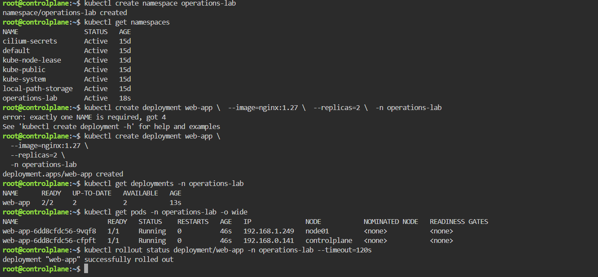
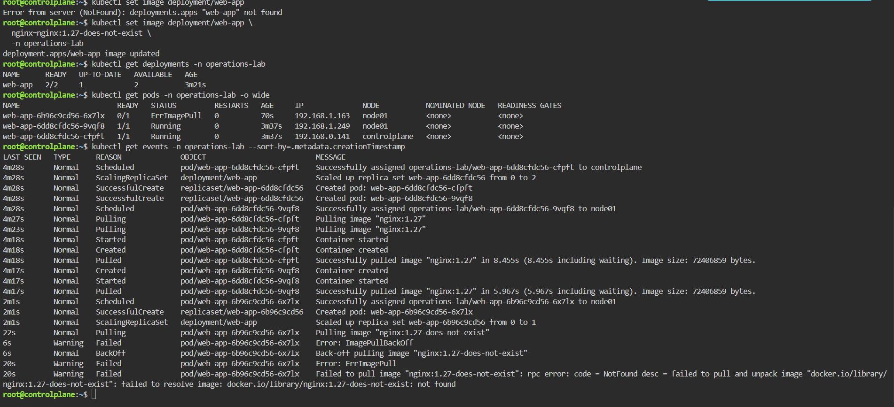
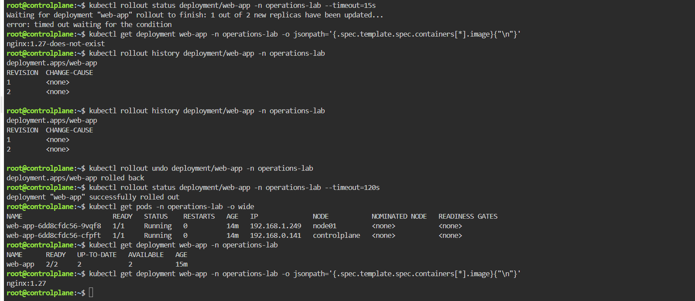
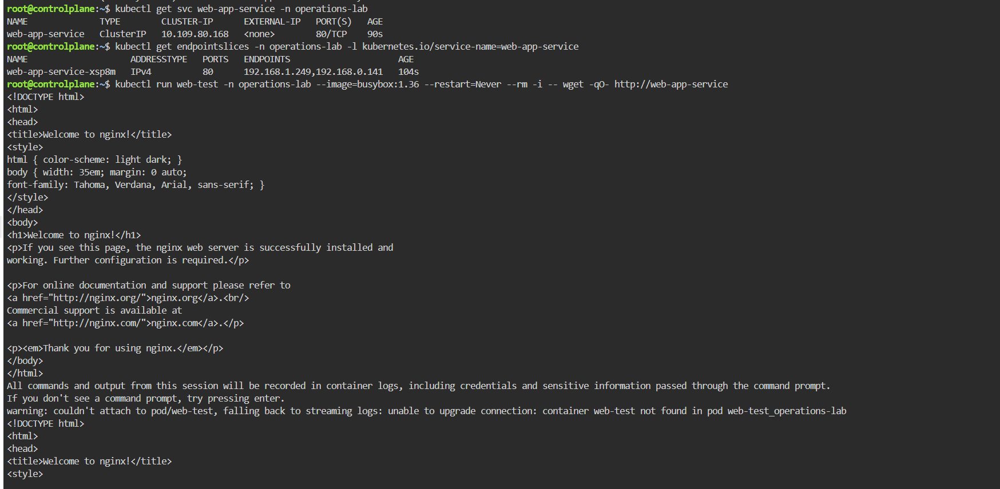
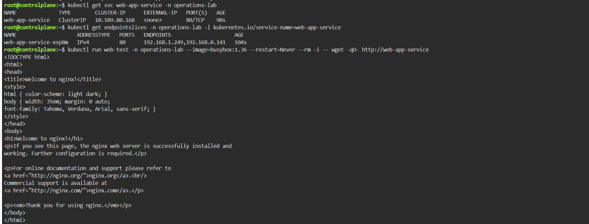

# Day 03 - Kubernetes Operations & Troubleshooting

## 1. Objective

Simulate and troubleshoot a failed Kubernetes Deployment caused by an invalid container image.

The objective of this lab is to practice Kubernetes operations, investigate deployment failures, recover application availability using a rollback, and verify connectivity through a Kubernetes Service.

**Technologies:** Kubernetes, kubectl, Nginx, Linux, containerd, BusyBox

**Environment:** Two-node Kubernetes cluster running Ubuntu 24.04 LTS, Kubernetes v1.37.1, and Cilium networking.

## 2. Initial Cluster Validation

Before deploying the application, I verified the health of the Kubernetes cluster.

```bash
kubectl get nodes -o wide
kubectl get pods -A
kubectl cluster-info
```

**Results:**

- Both `controlplane` and `node01` reported `Ready`.
- CoreDNS and Cilium components were running.
- The Kubernetes API server was reachable.

This confirmed that the cluster was operational before introducing the application.

## 3. Application Deployment

### Create a dedicated namespace

```bash
kubectl create namespace operations-lab
kubectl get namespaces
```

### Deploy Nginx with two replicas

```bash
kubectl create deployment web-app \
  --image=nginx:1.27 \
  --replicas=2 \
  -n operations-lab
```

### Verify deployment health

```bash
kubectl get deployments -n operations-lab
kubectl get pods -n operations-lab -o wide
kubectl rollout status deployment/web-app \
  -n operations-lab --timeout=120s
```

**Result:** The Deployment successfully rolled out with two available replicas.

The Nginx pods were distributed across the control-plane and worker nodes.



## 4. Simulating a Deployment Failure

To simulate an operational incident, I deliberately updated the Deployment to reference a nonexistent container image.

```bash
kubectl set image deployment/web-app \
  nginx=nginx:1.27-does-not-exist \
  -n operations-lab
```

### Inspect the Deployment

```bash
kubectl get deployments -n operations-lab
kubectl get pods -n operations-lab -o wide
```

**Observed symptoms:**

- The new pod entered `ErrImagePull`.
- Kubernetes subsequently reported `ImagePullBackOff`.
- The existing Nginx pods remained running.
- The Deployment was unable to complete its rolling update.

### Investigate Kubernetes events

```bash
kubectl get events -n operations-lab \
  --sort-by=.metadata.creationTimestamp
```

### Inspect the failing pod

```bash
kubectl describe pod <failing-pod-name> \
  -n operations-lab
```

The events identified the underlying problem:

```text
Failed to pull image "nginx:1.27-does-not-exist"
Error: ErrImagePull
Error: ImagePullBackOff
not found
```

**Root cause:** The Deployment referenced a nonexistent Nginx image tag, preventing Kubernetes from downloading and starting the replacement container.



## 5. Rollout Investigation and Recovery

### Confirm rollout failure

```bash
kubectl rollout status deployment/web-app \
  -n operations-lab --timeout=15s
```

**Result:** The rollout timed out because the replacement pod could not start.

### Inspect the configured image

```bash
kubectl get deployment web-app \
  -n operations-lab \
  -o jsonpath='{.spec.template.spec.containers[*].image}{"\n"}'
```

**Output:**

```text
nginx:1.27-does-not-exist
```

### Review rollout history

```bash
kubectl rollout history deployment/web-app \
  -n operations-lab
```

The Deployment contained two revisions: the original working configuration and the failed image update.

### Roll back to the previous working revision

```bash
kubectl rollout undo deployment/web-app \
  -n operations-lab
```

### Verify recovery

```bash
kubectl rollout status deployment/web-app \
  -n operations-lab --timeout=120s

kubectl get pods -n operations-lab -o wide

kubectl get deployment web-app -n operations-lab
```

**Results:**

- The rollback completed successfully.
- Both Nginx pods returned to `Running` with `1/1` readiness.
- The Deployment reported `2/2` ready replicas.
- The configured container image was restored to `nginx:1.27`.



## 6. Kubernetes Service and Connectivity Verification

After recovering the Deployment, I exposed the application through a Kubernetes ClusterIP Service.

### Create the Service

```bash
kubectl expose deployment web-app \
  -n operations-lab \
  --name=web-app-service \
  --port=80 \
  --target-port=80
```

### Verify the Service

```bash
kubectl get svc web-app-service -n operations-lab
```

**Result:** The Service was assigned ClusterIP `10.109.80.168` and exposed port `80/TCP`.

### Inspect EndpointSlices

```bash
kubectl get endpointslices \
  -n operations-lab \
  -l kubernetes.io/service-name=web-app-service
```

**Result:** The EndpointSlice contained the two application pod IPs, confirming that the Service was associated with the running application endpoints.

### Test application connectivity

```bash
kubectl run web-test \
  -n operations-lab \
  --image=busybox:1.36 \
  --restart=Never \
  --rm -i -- \
  wget -qO- http://web-app-service
```

**Result:** The request returned the Nginx welcome page HTML, confirming successful application connectivity through Kubernetes Service networking.





## 7. Key Lessons Learned

1. A Deployment can report ready replicas even when its latest rollout has failed.
2. `ErrImagePull` and `ImagePullBackOff` require investigation of pod events and image configuration.
3. Kubernetes rolling updates can preserve existing application availability during a failed replacement.
4. Rollout history and rollback commands provide a practical recovery mechanism.
5. Pod readiness alone is insufficient proof of end-to-end application health.
6. Service discovery, EndpointSlices, and HTTP requests provide additional recovery evidence.

## 8. Production Considerations

This failure was deliberately introduced in an isolated lab.

In production, I would validate container image tags before deployment, use CI/CD checks, monitor rollout health, configure appropriate readiness probes, and maintain a documented rollback procedure.

I would also verify application functionality after recovery rather than relying exclusively on Kubernetes resource status.

## 9. Lab Outcome

**Incident:** Failed Kubernetes rolling update

**Root cause:** Invalid Nginx container image tag

**Recovery:** Rollback to the previous working Deployment revision

**Validation:** Two healthy replicas, successful rollout, valid Service endpoints, and successful HTTP connectivity

**Final status: RESOLVED**
